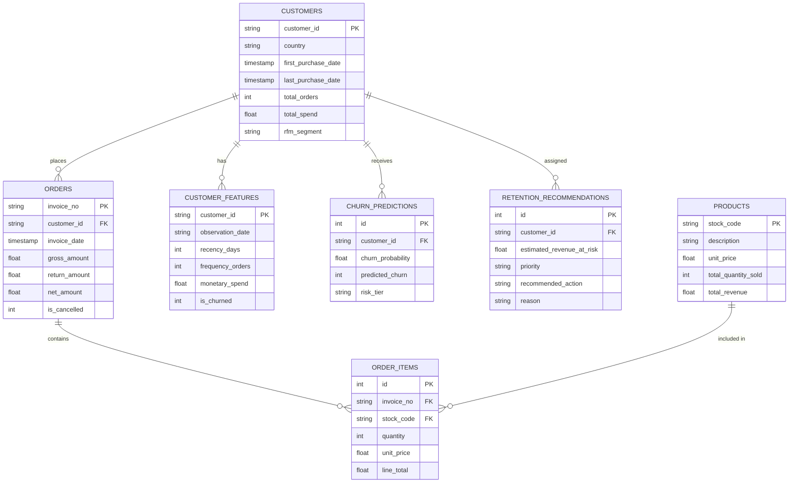

# Cartly – Retail Intelligence & Revenue Protection System

> **Tagline:** *Turn Customer Insights into Revenue Protection.*


---

## 1. Project Overview

**Cartly** is a real-world, enterprise-grade retail intelligence and revenue protection platform designed to bridge the gap between descriptive sales reporting and proactive customer retention. While traditional business intelligence dashboards summarize what happened in the past, Cartly leverages machine learning, temporal customer behavior analysis, and financial exposure modeling to quantify **which customers are defecting**, **how much revenue is actively at risk**, and **which retention interventions yield the highest ROI**.

Cartly is built from the ground up to solve the cold-start and leakage pitfalls common in customer churn analytics by employing a rigorous **historical snapshot architecture**, strict **chronological train/test splits**, and a transparent **revenue-at-risk financial protection baseline**.

---

## 2. Problem Statement

Retailers and e-commerce enterprises face severe revenue loss from silent customer attrition:
1. **Silent Attrition**: Unlike SaaS subscriptions where cancellations are explicit events, retail customers churn silently simply by not returning.
2. **Descriptive Inaction**: Standard dashboards display historical GMV, ignoring whether top-spending customers from previous quarters have stopped purchasing.
3. **Data Leakage in Predictive Modeling**: Typical data science projects use random train/test splits or aggregate features over the entire dataset timeline, leaking future purchase behavior into feature sets and rendering real-world model deployment ineffective.
4. **Disconnect Between Probabilities and Financial Decisions**: A 70% churn probability on a £50 account requires an entirely different business response than a 70% churn probability on a £5,000 enterprise buyer.

---

## 3. Project Objectives

- **Financial Integrity**: Rigorously separate Gross Sales, Returns, and Net Revenue without double-counting cancellations or invalid adjustments.
- **Customer Segmentation**: Provide configurable, transparent RFM (Recency, Frequency, Monetary) behavioral clustering.
- **Leakage-Free Predictive Machine Learning**: Operationalize a 180-day historical observation window and a 90-day future prediction window with chronological evaluation.
- **Smart Revenue Protection**: Quantify each customer's expected future revenue and calculate estimated revenue at risk:
  $$\text{Estimated Revenue at Risk} = \text{Churn Probability} \times \text{Estimated Future Revenue}$$
- **Actionable Retention Engine**: Automate heuristic retention recommendations with transparent business justifications and scientific disclaimers.
- **Modular Production Codebase**: Decouple data ingestion, cleaning, feature engineering, modeling, business logic, and UI across reusable modules backed by SQLite storage.

---

## 4. Key Application Features & Modules

### Module 1: Executive Dashboard
- **Executive KPIs**: Net Realized Revenue (£), Gross Sales (£), Returns & Offsets (£), Return Rate (%), Order Count, Active Accounts, Catalog SKUs, Average Order Value (AOV), and Items per Order.
- **Monthly Performance & Returns Trajectory**: Interactive Plotly grouped bar and line visualization tracking monthly gross billings, refunds, and net revenue.
- **Customer Purchasing Dynamics**: Monthly active transacting accounts and average spend per customer over time.
- **Global Filters**: Interactive date-range picker and multi-country filter updating all metrics dynamically.

### Module 2: Product Revenue Analysis
- **Product-Wise Performance**: Comprehensive table covering SKU units dispatched, units returned, gross sales, return amounts, and net revenue.
- **Top 10 Products**: Ranked by net revenue or quantity sold with interactive color scales.
- **Lowest-Performing Inventory**: Identifies dead stock, low-turnover items, or products with excessive return rates.
- **Product Sales Trajectory**: Multi-product monthly revenue time series comparison.

### Module 3: Customer Analytics (RFM Segmentation)
- **Quintile Behavioral Scoring**: Scores Recency (1–5), Frequency (1–5), and Monetary (1–5) metrics.
- **Configurable Segments**:
  - `Champions`: Recent, high-frequency, top-tier spenders.
  - `Loyal Customers`: Steady, dependable repeat purchasers.
  - `Potential Loyalists`: Recent buyers with moderate order history.
  - `Promising / Recent`: Recent first-time or low-frequency accounts.
  - `Needs Attention`: Above-average historical spenders whose recency is slipping.
  - `At Risk`: Past VIPs who have not purchased in over 90–120 days.
  - `Hibernating`: Dormant accounts with low frequency and spend.
- **Interactive Visualizations**: 3D/2D RFM bubble scatter plot (bubble size = Monetary spend) and Treemap showing revenue distribution across segments.
- **Customer Profile Lookup**: Instant search by Customer ID to retrieve RFM scores, segment status, and historical metrics.

### Module 4: Customer Churn Prediction
- **Operational Churn Protocol**:
  - 180-day historical feature window.
  - 90-day future observation window.
  - Churn label: $y = 1$ if zero valid purchases occur during the 90 days following observation date, else $y = 0$.
  - Strictly chronological split eliminating lookahead bias.
- **One-Click Re-Training**: Interactive training button evaluating Logistic Regression and Random Forest classifiers on the fly.
- **Risk Tiers**: Automatically classifies accounts into High ($\ge 70\%$), Medium ($35\% - 70\%$), and Low ($< 35\%$) churn probability.
- **Individual Churn Search**: Real-time risk probability lookup for any customer ID.

### Module 5: Smart Revenue Protection Engine *(Cartly Signature Feature)*
- **Baseline Exposure Formula**:
  $$\text{Estimated Future Revenue} = \left(\frac{\text{Spend in 180-day Window}}{180}\right) \times 90$$
  $$\text{Estimated Revenue at Risk} = \text{Churn Probability} \times \text{Estimated Future Revenue}$$
- **Customer Prioritization Matrix**:
  - **Critical**: High Risk ($\ge 70\%$) AND High Value (top 25% future revenue).
  - **High**: High Risk + Medium Value OR Medium Risk + High Value.
  - **Medium**: Medium Risk + Medium Value OR High Risk + Low Value.
  - **Low**: Stable / Low-Risk accounts.
- **Visual Matrix**: Interactive quadrant scatter plot plotting Future Revenue vs. Churn Probability with bubble size reflecting total Revenue at Risk.
- **Ranked Exposure Table & CSV Export**: Downloadable table ranking customers by financial exposure to guide immediate account interventions.

### Module 6: Smart Retention Recommendations
- **Rule-Based Action Matrix**:
  - *High Risk + High Value*: **VIP Concierge Retention Outreach & Exclusive Loyalty Incentive** (high-touch account manager call, bespoke 20% renewal discount).
  - *High Risk + Mid Value*: **Automated Win-Back Campaign** (3-part category email reactivation series).
  - *High Risk + Low Value*: **Low-Cost Automated Win-Back** (low-margin free shipping voucher).
  - *Low Risk + High Value*: **Loyalty Expansion & VIP Previews** (exclusive tier perks, beta access).
  - *High Return Rate Trigger ($\ge 20\%$)*: Appends post-return quality survey and sizing consult.
- **Scientific Transparency Disclaimer**: Transparently notes that recommendations are heuristic models requiring controlled A/B testing before claiming causal churn prevention.

### Module 7: Model Performance Benchmark
- **Side-by-Side Model Evaluation**: Direct comparison of Logistic Regression vs. Random Forest across Accuracy, Precision, Recall, F1-Score, ROC-AUC, and PR-AUC.
- **Confusion Matrix Heatmaps**: Real visual breakdown of True Positives, False Positives, False Negatives, and True Negatives.
- **ROC and PR Curves**: Comparative interactive curves displaying model discriminative power and class-imbalance resilience.
- **Feature Importance Ranking**: Random Forest Gini feature importances vs. Logistic Regression standardized weight coefficients.

### Module 8: Data Management & SQLite Relational Store
- **File Ingestion**: Seamless drag-and-drop support for CSV and Excel (`.xlsx`, `.xls`) files.
- **Schema Validation**: Automatic column alias normalization and missing-column detection.
- **Data Quality Diagnostics**: Real-time audit of duplicate rows, cancellation codes (`C`-invoices), negative quantities, and missing customer IDs.
- **SQLite Database Management**: Syncs cleaned data to 7 normalized relational tables (`customers`, `products`, `orders`, `order_items`, `customer_features`, `churn_predictions`, `retention_recommendations`) with primary keys, foreign keys, and indexes.

---

## 5. Technology Stack

| Layer | Technologies |
|---|---|
| **Core Language** | Python 3.11+ |
| **Data Manipulation** | Pandas, NumPy |
| **Machine Learning** | Scikit-Learn, Joblib |
| **Web Application** | Streamlit |
| **Interactive Plotting**| Plotly Graph Objects & Express |
| **Relational Database** | SQLite 3 |
| **Excel Ingestion** | OpenPyXL |
| **Testing & Quality** | Pytest |

---

## 6. Dataset Information

The application is built and tested on the **Kaggle Online Retail II Dataset** (sourced from the UCI Machine Learning Repository):
- **Source Link**: [Kaggle Online Retail Dataset](https://www.kaggle.com/datasets/lakshmi25npathi/online-retail-dataset)
- **Period**: Dec 1, 2009 – Dec 9, 2011 (~24 months, 1,067,371 transactions)
- **Original Currency**: British Pound Sterling (GBP / £)
- **Canonical Schema**:
  - `Invoice`: 6-digit order identifier (prefixed with `C` if cancelled/returned)
  - `StockCode`: 5-digit product code
  - `Description`: Item title/name
  - `Quantity`: Number of units transacted (negative for cancellations/returns)
  - `InvoiceDate`: Timestamp of order generation
  - `Price`: Unit price in GBP (£)
  - `Customer ID`: 5-digit unique customer identifier (null for guest transactions)
  - `Country`: Customer geographic residence

### Pre-packaged Datasets Available in Cartly:
1. `data/sample_retail_50k.csv` / `.xlsx`: High-speed 50,000-row sample spanning the full 24 months for instant startup, testing, and presentation.
2. `data/online_retail_II.csv`: Full 1,067,371 records for comprehensive deep-data analytics.
3. Custom File Upload: Upload any CSV or Excel file containing the canonical retail columns.

---

## 7. Machine Learning & Churn Methodology

```
|<------------------- 180-Day History Window ------------------->|<--- 90-Day Target Window --->|
|   (Transactions used strictly for feature engineering)          |   (Evaluate purchase count)   |
|-----------------------------------------------------------------|-------------------------------|
                                                                  ^
                                                           Observation Date
                                                      Features: Recency, Spend, etc.
                                                      Label: is_churned = (Orders == 0)
```

### Feature Engineering Protocol
Features are constructed strictly from events occurring on or before the Observation Date ($T_{obs}$):
- `recency_days`: Days elapsed between customer's latest purchase and $T_{obs}$.
- `frequency_orders`: Total distinct purchase orders within the 180-day window.
- `monetary_spend`: Total net spend in GBP within the window.
- `avg_order_value`: Average transaction value ($\text{Monetary} / \text{Frequency}$).
- `total_quantity`: Sum of all units purchased in the window.
- `cancellation_count`: Count of return/cancellation actions.
- `cancellation_rate`: Ratio of cancellations to total orders.
- `distinct_products_count`: Number of distinct SKUs purchased.
- `avg_days_between_purchases`: Mean cadence between repeat purchase orders.
- `tenure_days`: Time elapsed between customer's first observed order and $T_{obs}$.

### Temporal Train / Test Splitting
To eliminate temporal lookahead bias and data leakage:
- **Dual Snapshot Protocol**: If dataset span $\ge 360$ days, Cartly builds a historical training snapshot at $T_{obs} - 90$ days and a subsequent test snapshot at $T_{obs}$. Both snapshots maintain non-overlapping target windows.
- Models trained:
  1. **Logistic Regression** (with `StandardScaler` pipeline and balanced class weights).
  2. **Random Forest Classifier** (`n_estimators=100`, balanced class weighting, constrained depth to prevent overfitting).

---

## 8. Relational Database Architecture (SQLite)

The database schema (`database/cartly_schema.sql`) implements relational structure with foreign keys and performance indexes:



---

## 9. Project Directory Structure

```
Cartly/
├── app/                        # Streamlit Web Application Layer
│   ├── main.py                 # Multi-module Streamlit dashboard application
│   ├── components.py           # Interactive Plotly visualizers & chart builders
│   └── styles.py               # Custom CSS design system, KPI cards & badges
├── database/                   # SQLite Database Layer
│   ├── cartly_schema.sql       # Relational SQL schema with indexes & foreign keys
│   └── cartly.db               # Pre-populated SQLite database (7 tables)
├── data/                       # Datasets
│   ├── sample_retail_50k.csv   # 50,000-row instant sample (CSV)
│   ├── sample_retail_50k.xlsx  # 50,000-row instant sample (Excel)
│   ├── online_retail_II.csv    # Full 1.07M-row Kaggle dataset (CSV)
│   └── online_retail_II.xlsx   # Full Kaggle Excel workbook
├── models/                     # Saved Machine Learning Artifacts
│   └── cartly_churn_model.joblib # Persisted best classifier & comparative metadata
├── notebooks/                  # Reproducible Demonstration Notebooks
│   └── 01_cartly_exploratory_and_pipeline.ipynb # End-to-end Python pipeline
├── src/                        # Modular Source Code
│   ├── analytics/              # Descriptive & RFM Analytics
│   │   ├── executive.py        # Executive KPIs, monthly & customer trends
│   │   ├── product_analytics.py# Product revenue, top/bottom sellers, monthly trends
│   │   └── rfm.py              # RFM calculation, scoring, and segmentation
│   ├── business/               # Revenue Protection & Retention Engine
│   │   ├── revenue_protection.py # Revenue at Risk formulas and priority matrix
│   │   └── recommendations.py    # Rule-based tailored retention actions
│   ├── data/                   # Ingestion, Cleaning & DB Operations
│   │   ├── cleaner.py          # Cancellation detection & financial cleaning
│   │   ├── db.py               # SQLite connection manager & query helpers
│   │   ├── loader.py           # CSV/Excel parsing and schema validator
│   │   └── repository.py       # Relational sync of orders, customers & features
│   ├── features/               # Feature Engineering
│   │   └── churn_features.py   # Historical snapshots & chronological splitter
│   └── models/                 # Predictive Modeling
│       └── churn_model.py      # Logistic Regression & Random Forest training
├── tests/                      # Pytest Automated Test Suite (16 Unit Tests)
│   ├── test_churn_pipeline.py  # Churn labels, leakage prevention & inference
│   ├── test_data_cleaning.py   # Cancellations, duplicates & invalid prices
│   ├── test_database_sync.py   # Relational table integrity in SQLite
│   ├── test_recommendations.py # Heuristic action matrix and disclaimers
│   ├── test_revenue_analytics.py # Financial KPI formulas & monthly breakdown
│   ├── test_revenue_protection.py # Signature Revenue-at-Risk formula
│   └── test_rfm.py             # Recency, Frequency, Monetary scoring logic
├── requirements.txt            # Python dependencies
├── run_cartly.py               # Python entrypoint launcher
├── run_cartly.bat              # Windows one-click executable launcher
└── README.md                   # Complete system documentation
```

---

## 10. Installation & Local Execution

### Prerequisites
- Python 3.10, 3.11, or 3.12 installed on your system.

### Step 1: Clone or Navigate to the Workspace
```bash
cd "c:/Users/ASUS/Downloads/MIcro project"
```

### Step 2: Install Required Dependencies
```bash
pip install -r requirements.txt
```

### Step 3: Run Automated Test Suite
Verify that all unit and integration tests pass:
```bash
pytest tests -v
```

### Step 4: Launch the Cartly Application
You can start Cartly using any of the following methods:

**Method A (Direct Streamlit):**
```bash
streamlit run app/main.py
```

**Method B (Python Launcher Script):**
```bash
python run_cartly.py
```

**Method C (Windows One-Click Launcher):**
Double-click `run_cartly.bat` in File Explorer.

Once launched, open your web browser at:
```
http://localhost:8501
```

---

## 11. Screenshots & Interface Overview

````carousel
### Module 1: Executive Dashboard

*Executive overview featuring Gross vs Returns vs Net Revenue, AOV, Monthly Trajectory, and Top Products.*
<!-- slide -->
### Module 3: Customer RFM Segmentation
*Interactive 3D/2D scatter plot and Treemap clustering accounts into Champions, Loyal Customers, At Risk, and Hibernating.*
<!-- slide -->
### Module 5: Smart Revenue Protection Engine
*Cartly Signature Feature: Future Revenue vs Churn Probability scatter plot with Customer Risk Prioritization ranking.*
<!-- slide -->
### Module 7: Model Performance Benchmark
*Side-by-side comparison of Logistic Regression vs. Random Forest with Confusion Matrices, ROC Curves, and Feature Importance.*
````

---

## 12. Limitations & Future Enhancements

### Limitations
- **Observational Heuristics**: The baseline revenue protection formula assumes future run-rate spend mirrors historical run-rate spend. Sudden macro-economic shifts or supply shocks are not accounted for.
- **Observational Disclaimers**: Retention recommendations are rule-based and cannot assert causal churn prevention without randomized control trials (A/B testing).
- **Guest Transactions**: Transactions with missing `Customer ID` (guest checkouts) are excluded from customer-level RFM and churn modeling to maintain mathematical validity, though accounted for in aggregate revenue metrics.

### Future Enhancements
- **Causal Uplift Modeling**: Train two-model or X-Learner uplift algorithms to predict individual Treatment Effect (ITE) rather than raw churn probability.
- **Automated CRM Webhook Integrations**: Push Critical retention action plans directly to HubSpot, Klaviyo, or Salesforce.
- **Survival Analysis**: Implement Cox Proportional Hazards and Weibull models to estimate time-to-churn continuously rather than across fixed 90-day binary windows.
